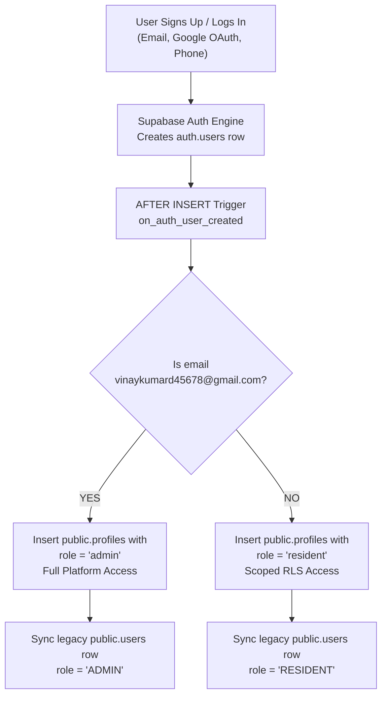

# PARCELFLOW — ADMIN AUTHENTICATION & ROLE PROMOTION GUIDE
**Designated Administrator:** `vinaykumard45678@gmail.com`  
**Security Architecture:** Supabase Auth + PostgreSQL Triggers + Row Level Security (RLS)  
**Database Script:** `database/auth_and_admin_setup.sql`  

---

## 1. Overview & Architecture

ParcelFlow implements a zero-trust, production-grade identity architecture that strictly separates authentication credentials from domain authorization profiles:
- **Authentication Source of Truth:** Handled by Supabase Auth (`auth.users`).
- **Profile & Authorization:** Maintained in `public.profiles` where the primary key `id` is a foreign key referencing `auth.users(id)`.
- **Identity Invariant:** User permissions are **never** granted on unverified email strings alone; queries and RLS policies evaluate `auth.uid() = profiles.id`.
- **Designated Root Admin:** Any account created with email `vinaykumard45678@gmail.com` is automatically provisioned with `role = 'admin'` through an immutable PostgreSQL database trigger (`public.handle_new_user()`).

---

## 2. Automatic Admin Trigger Workflow



### Key Security Safeguards
1. **Case-Insensitive Normalization:** Email checking uses `LOWER(TRIM(email))` so variations like `VinayKumarD45678@gmail.com` receive proper elevation.
2. **Anti-Role-Elevation Trigger (`prevent_role_elevation`):** Regular users cannot elevate their role to `admin` through client updates or API parameters. Updates modifying the `role` column trigger an immediate SQL exception unless executed by an authenticated administrator.
3. **Multi-Society Administration:** The designated admin account retains global access across all societies, storage racks, parcels, and audit logs.

---

## 3. How `vinaykumard45678@gmail.com` Becomes the Verified Admin

### Method 1: Email & Password Signup (Web or Admin Portal)
1. Navigate to the ParcelFlow login/signup interface or call the client SDK:
   ```typescript
   import { signUpWithEmail, signInWithEmail } from './backend/supabase_client';

   // 1. Sign up
   const result = await signUpWithEmail(
     'vinaykumard45678@gmail.com',
     'YourSecurePassword123!',
     'Vinay Kumar',
     '+91 99999 88888'
   );
   console.log('Admin Profile Created:', result.profile);
   // Result: { role: 'admin', email: 'vinaykumard45678@gmail.com', ... }
   ```
2. The `on_auth_user_created` trigger automatically intercepts the signup and writes:
   - `public.profiles`: `role = 'admin'`
   - `public.users`: `role = 'ADMIN'`
3. Log in with `signInWithEmail('vinaykumard45678@gmail.com', 'YourSecurePassword123!')`.

---

### Method 2: Google 1-Click OAuth (Recommended)
1. Trigger Google sign-in using the frontend helper:
   ```typescript
   import { signInWithGoogle } from './backend/supabase_client';

   await signInWithGoogle('https://parcelflow-blush.vercel.app/admin');
   ```
2. When signing in with the Google Account `vinaykumard45678@gmail.com`:
   - Supabase creates the `auth.users` entry with verified email.
   - The PostgreSQL trigger instantly executes, populates the profile, and grants root `admin` permissions.

---

### Method 3: Direct SQL Promotion (Pre-existing Users)
If the account already exists in Supabase prior to executing the migration script:
1. Open the **Supabase Dashboard** -> **SQL Editor**.
2. Run the backfill script included at the bottom of `database/auth_and_admin_setup.sql`:
   ```sql
   SELECT public.promote_user_to_admin('vinaykumard45678@gmail.com');
   ```
3. Or manually verify with:
   ```sql
   SELECT p.id, p.full_name, p.email, p.role, p.created_at
   FROM public.profiles p
   WHERE p.email = 'vinaykumard45678@gmail.com';
   ```

---

## 4. Row Level Security (RLS) Policy Specifications

| Table | Resident Access | Hub Staff Access | Admin Access (`vinaykumard45678@gmail.com`) |
|---|---|---|---|
| `profiles` | SELECT & UPDATE own profile (cannot modify `role`) | SELECT profiles within their assigned society | FULL (SELECT, UPDATE, DELETE all profiles) |
| `parcels` | SELECT & UPDATE own parcels (matching `resident_id` or apartment) | FULL access to parcels within their society | FULL access across all societies and racks |
| `storage_locations` | SELECT lockers in their society | Manage compartment occupancy & rack assignment | FULL management across all hubs |
| `pickup_slots` | SELECT available slots | Adjust slot capacity & view bookings | Configure society pickup time windows |
| `handover_tokens` | View own active OTP & QR passes | Verify & consume handover tokens at parcel desk | Audit and inspect all token lifecycles |
| `audit_logs` | No access | INSERT handover audit trail entries | FULL read access to society security logs |

---

## 5. Client SDK Auth Helpers Reference

Both `backend/supabase_client.ts` and `src/utils/supabase.ts` export unified authentication functions:

```typescript
import {
  signUpWithEmail,
  signInWithEmail,
  signInWithGoogle,
  signInWithPhoneOtp,
  verifyPhoneOtp,
  getCurrentUserProfile,
  signOut
} from './backend/supabase_client';

// 1. Check current logged-in user and role
const { user, profile, isAdmin } = await getCurrentUserProfile();
if (isAdmin) {
  console.log('Welcome Root Admin:', profile?.full_name);
}

// 2. Mobile / Web Sign Out
await signOut();
```

---

## 6. Supabase Deployment Checklist

1. **Apply SQL Migration:**
   - Copy `database/auth_and_admin_setup.sql` into the Supabase SQL editor.
   - Click **Run**.
2. **Verify Trigger Existence:**
   ```sql
   SELECT trigger_name, event_manipulation, event_object_table
   FROM information_schema.triggers
   WHERE trigger_name = 'on_auth_user_created';
   ```
3. **Verify RLS Status:**
   ```sql
   SELECT tablename, rowsecurity
   FROM pg_tables
   WHERE schemaname = 'public' AND tablename IN ('profiles', 'parcels', 'societies');
   ```
4. **Log in with `vinaykumard45678@gmail.com`:**
   - Launch `admin-dashboard` or mobile app.
   - Authenticate as `vinaykumard45678@gmail.com`.
   - Admin badge will automatically display on the dashboard header!
